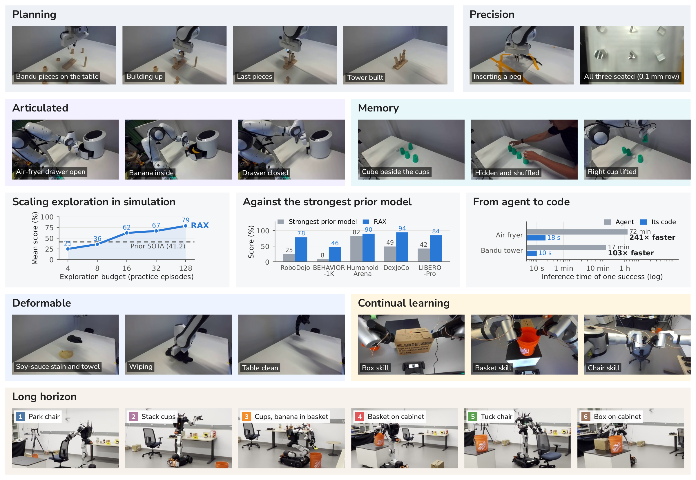

# RAX: Scaling Online Exploration for Robot Agents

<b>R</b>obot <b>A</b>gent e<b>X</b>ploration: an open-source platform on which coding agents learn robot tasks by exploring

 

  

 

Runhan&nbsp;Huang1,\*, Xiangcheng&nbsp;Zhang1,\*,†, Haoyu&nbsp;Chen1,‡, Yitong&nbsp;Li2,‡, Yen-Jen&nbsp;Wang3,‡, Bohan&nbsp;Lyu3,‡, Haoyu&nbsp;Xiong4, Yangzhen&nbsp;Wu3, Chuye&nbsp;Hong3, Haotian&nbsp;Ye5, Yixuan&nbsp;Wang2, Travis&nbsp;Manderson4, Stefano&nbsp;Ermon5, Dawn&nbsp;Song3, Pieter&nbsp;Abbeel3, Qianqian&nbsp;Wang1, Antonio&nbsp;Torralba4, Weirui&nbsp;Ye4, Yilun&nbsp;Du1

1Harvard University &nbsp; 2NVIDIA &nbsp; 3UC Berkeley &nbsp; 4MIT &nbsp; 5Stanford University

\*Equal contribution &nbsp; †Project lead &nbsp; ‡Core contributor

 

<picture>
  <source media="(prefers-color-scheme: dark)" srcset="assets/affiliations_dark.png">
  
</picture>

 

  

## 💡 Overview

RAX is an open-source framework for robot agents built around one principle, **scaling exploration**: a robot agent should improve by gathering its own online experience and optimizing its own programs. A general-purpose coding agent programs the robot directly, with no teleoperation corpus, no hand-engineered action primitives and no value-function guidance. It explores online, finds the decisions that make a task succeed, and compiles them into modular programs that run the full perception, planning and control loop on their own. The language model's weights never change. What the agent learns lives in a persistent workspace of programs, notes and verified skills.

## ✨ Highlights

- 📈 **Exploration scales.** Performance on unseen scenes rises steadily as the exploration budget grows.
- 🦾 **One agent, many embodiments.** Single-arm, bimanual, dexterous, mobile and humanoid robots, across six simulation benchmarks and two real robots (Franka and Rainbow RB-Y1). A new robot joins through its API alone, with no data collection and no policy training.
- 🏆 **State of the art in simulation.** RAX surpasses the strongest prior models by **+37.4** on average.
- ⚡ **From exploration to code.** The agent's discoveries become fully automated programs that solve real-robot tasks two orders of magnitude faster than the agent itself.
- 🔁 **Continual learning on real robots.** Memory-dependent, articulated, high-precision, deformable and long-horizon mobile manipulation tasks are learned through autonomous exploration, and skills verified in earlier sessions compose into longer ones.

## 🔥 News

- **[2026-10]** 🌐 The [project page](https://robot-agent-exploration.com) is live. The code release is in progress; ⭐ star or 👀 watch this repository to be notified.

## 🗺️ Release Plan

- [x] Project page
- [ ] RAX in simulation
- [ ] RAX in the real world

## 📖 Citation

BibTeX coming soon.

## 📄 License

RAX is released under the [MIT License](LICENSE).
